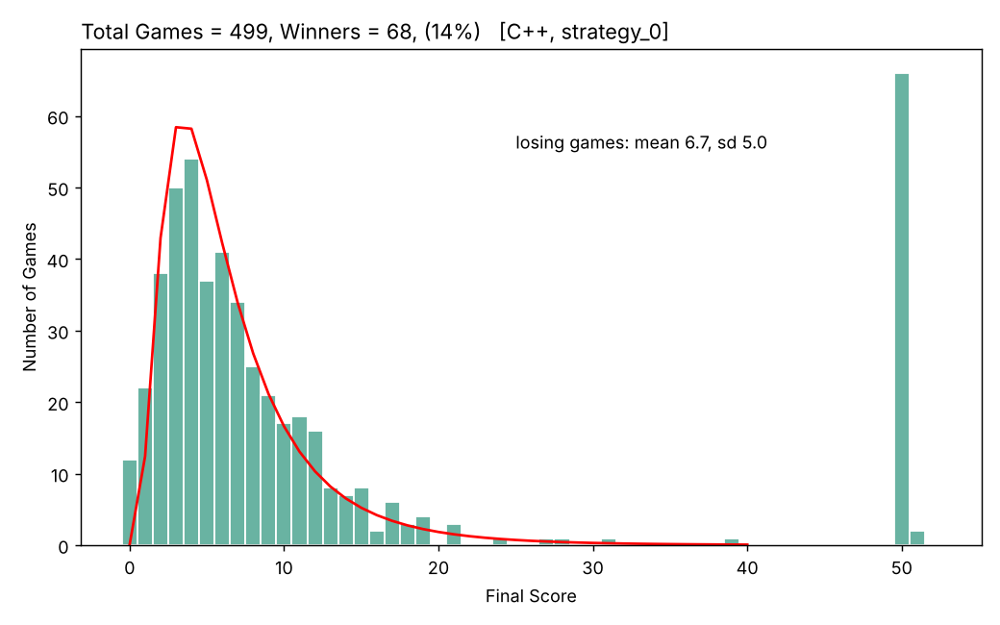

# How many Klondike games can be won?

R. T. Nachtrieb & Claude

People who play Klondike solitaire win about one game in ten. This project asks a different
question: how many games *could* be won? It models Klondike on a computer, plays the same
501 deals with several strategies, and compares the results deal by deal.

It started as a short note in R ([`ref/note/20250719_solitaire.pdf`](ref/note/20250719_solitaire.pdf)).
The note plays 499 deals with a simple look-ahead strategy and wins 68 of them (14%). This
repository adds a C++ port of that R code which gives identical results, three more
strategies, and a backtracking search that finds the most games that can be won under the
model's rules.

**Results in short** (501 deals, draw three, unlimited passes through the hand):

| Strategy | Idea | Games won |
|---|---|---|
| `strategy_0` | the note's strategy: play the move that leads to the most moves | 68 (13.6%) |
| `strategy_1` | simple preferences: send cards to the suits, turn up face-down cards | 52 (10.4%) |
| `strategy_2` | `strategy_0`, looking one move further ahead | 72 (14.4%) |
| `strategy_3` | backtracking search: can the deal be won at all? | 354 (70.7%) found, 53 proven impossible, 94 unresolved |

Between **72.7% and 89.4%** of deals can be won under these rules. The step-by-step
strategies win only 10–14%, and none of them is significantly better than another.

---

## Contents

1. [Definitions](#definitions)
2. [Possible moves](#possible-moves)
3. [Strategies](#strategies)
4. [Results](#results)
5. [What the numbers mean](#what-the-numbers-mean)
6. [Reproducing the results](#reproducing-the-results)
7. [Repository layout](#repository-layout)

---

## Definitions

These follow the note.

- **Cards.** There are 52 cards, numbered 1–52: AC…KC, AD…KD, AH…KH, AS…KS. Face values are
  A = 1, 2–9, T = 10, J = 11, Q = 12, K = 13. Clubs and spades are black; diamonds and hearts
  are red.
- **Columns.** Every card sits in one of 12 columns:
  - 1–4: the four **suits** (foundations), in the order C, D, H, S;
  - 5–11: the seven **piles** (the tableau);
  - 12: the **hand** (stock and waste together).
  A column holds at most 24 cards, in positions 1, 2, 3, … with no gaps.
- **Face up / face down.** Every card is face up or face down. The code stores this as the
  sign of its position: positive is face up, negative is face down.
- **State.** The column, position and face of every card. It is stored as 104 numbers: the
  column of cards 1–52, then the signed position of cards 1–52.
- **Sorted state.** Swapping two piles doesn't change which moves are possible. So the piles
  are put in a fixed order (by card count, then by top card), and states that differ only by
  pile order count as equal.
- **Deal.** The starting state. Pile *k* gets *k* cards with only the top one face up. The
  other 24 cards go to the hand. The 501 deals (seeds 0–500) were made by the R code and
  saved in [`cpp/seed_ch.csv`](cpp/seed_ch.csv), so every strategy plays exactly the same games.
- **Move** (state transition). A legal change from one state to a different state.
- **Final state.** A state where the strategy stops: there is no legal move, or the strategy
  finds none worth playing.
- **Trajectory.** The sequence of states from the deal to the final state.
- **Score.** The number of cards on the suits in the final state, 0–52.
- **Win.** All 52 cards on the suits.

## Possible moves

General rules:

- Only face-up cards move. A face-up card on a pile takes every card on top of it along (a
  run of alternating colours and falling rank).
- When a move uncovers a face-down card on a pile, that card turns face up automatically.
  Turning a card is not a move of its own.
- A strategy may not go back to a state it has already visited.
- A card on the suits stays there. Moving a card from the suits back to a pile is allowed in
  the usual rules, but not in this model (see [What the numbers mean](#what-the-numbers-mean)).

**The hand (draw three).** The hand is one column of 24 or fewer cards. After a reset, every
third card is face up, plus the last card. These are exactly the cards a player sees when
turning the hand over three at a time. Any face-up card in the hand can be played. When one is
played, the card just before it turns face up (it is now the top of the waste), and the cards
before that turn face down (they have gone by in this pass). The cards after it keep their
pattern. A reset starts a new pass. There is no limit on the number of passes.

The five kinds of move, in the order the code lists them:

1. **Reset the hand.** Restore the every-third-card-up pattern, i.e. start a new pass. Allowed
   when the hand is not already in that pattern.
2. **Ace to suit.** An ace on top of a pile, or face up in the hand, goes to its suit.
3. **Card to suit.** A non-ace on top of a pile, or face up in the hand, goes onto the card one
   lower of the same suit.
4. **King to an empty pile.** A face-up king, from the hand or from a pile where it is not
   already at the bottom, goes to an empty pile (taking any cards on top of it).
5. **Onto a pile.** A face-up card (with the cards on top of it), from another pile or the
   hand, goes onto a pile whose top card is one higher and of the other colour.

For example, the deal for seed 0 has six legal moves: AD and AS from the hand to their suits;
TD from one pile onto JC on another; AS from the hand onto 2H; and QH from the hand onto KC or
onto KS (Figure 2 of the note).

## Strategies

All strategies use the same move generator (`get_moves`) and move function (`make_move`), so
they play by the same rules. When a strategy stops, any cards that can still go to the suits
are sent there (`finished` in the results). This counts a game as won when only the
obvious last moves are missing.

**`strategy_0`, look ahead two moves** (the note's strategy, R's `one_step.R`). For each legal
move, count the two-move sequences that can follow it. Play the move with the highest count.
The idea: there is only one winning state, and a game is lost when the moves run out, so keep
the most moves available. Moves that return to a visited state are skipped. Ties go to the
move listed first. The strategy stops when every count is zero.

**`strategy_1`, simple preferences.** These are the rules of thumb many players use:
1. If a card can go to the suits, send it.
2. Else, if a move turns up a face-down card, play it, starting with the pile that has the most
   face-down cards.
3. Else, use `strategy_0`'s rule.

**`strategy_2`, look ahead three moves.** The same as `strategy_0`, but each move is scored
by the number of three-move sequences that follow it. Nothing else changes, so comparing it
with `strategy_0` shows only the effect of looking further ahead.

**`strategy_3`, backtracking search.** A depth-first search over all moves, tried in
`strategy_1`'s order. At a dead end it undoes the last move and tries the next one. It never
enters a state twice. It ends when it finds a win, when it has tried every reachable state
(`exhausted`: the deal **cannot** be won under these rules), or after 2,000,000 states
(`limit`: unknown). Undoing a move after seeing the card it turned up amounts to knowing the
face-down cards. So `strategy_3` is not a way to play. It answers whether a deal can be won
at all.

## Results

All numbers come from [`results/results.csv`](results/results.csv) and
[`results/compare_strategies.txt`](results/compare_strategies.txt).

### The note, reproduced



The C++ port of `strategy_0` matches the R code state by state in all 499 games that the R
runs saved ([`results/compare_R.txt`](results/compare_R.txt)). It wins 68 of 499 (13.6%). In the
games it loses, the mean score is 6.7 (standard deviation 5.0), roughly log-normal, as in the
note. Seeds 222 and 317 have no useful first move, so they end at once. The R runs skipped
them, and the figure leaves them out.

### All strategies on the same 501 deals

| Strategy | Wins | Win % | Mean finished score |
|---|---|---|---|
| `strategy_0` | 68 | 13.6% | 12.9 |
| `strategy_1` | 52 | 10.4% | 14.3 |
| `strategy_2` | 72 | 14.4% | 13.3 |
| `strategy_3` | 354 | 70.7% | 40.2 |

Every strategy plays the same deals, so the comparison is paired. Only the deals where two
strategies disagree tell them apart. The test is an exact McNemar test on those deals:

| Pair | Both win | Only first wins | Only second wins | McNemar p |
|---|---|---|---|---|
| `strategy_0` vs `strategy_1` | 18 | 50 | 34 | 0.10 |
| `strategy_0` vs `strategy_2` | 41 | 27 | 31 | 0.69 |
| `strategy_1` vs `strategy_2` | 13 | 39 | 59 | 0.054 |

- **Simple preferences don't help.** If anything, `strategy_1` does worse than `strategy_0`.
  Sending low cards to the suits early takes away cards the piles need for building. Its
  losing games end with more cards on the suits, but it finishes fewer games.
- **Looking further ahead doesn't help either.** `strategy_2` wins 4 more games than
  `strategy_0`, which is well within chance, and takes about 9 times longer.
- **The strategies win different deals.** Together, strategies 0–2 win 130 different deals,
  against 72 for the best one alone. A better step-by-step player has room to improve.

### How many deals can be won?

| `strategy_3` outcome | Deals |
|---|---|
| won (a winning line was found) | 354 |
| exhausted (proven impossible under these rules) | 53 |
| unresolved (gave up after 2,000,000 states) | 94 |

Ten of the 94 unresolved deals are won by one of strategies 0–2, so at least 364 deals can be
won. At most 448 can (all but the 53 proven impossible):

**72.7% ≤ winnable ≤ 89.4%** (of 501 deals, under this model's rules).

The results agree with each other: no deal won by strategies 0–2 is called impossible by the
search. Most wins are found quickly (median 827 states; 90% within 275,000). The unresolved
deals are a hard tail.

## What the numbers mean

- **Comparison with published work.** Blake & Gent (2019; *JAIR*, 2026) solved Klondike in
  the "thoughtful" variant, where the player knows every card, and found
  **81.945% ± 0.084%** of deals winnable ([arXiv:1906.12314](https://arxiv.org/abs/1906.12314)).
  Searching with undo is effectively the thoughtful game, so our bounds should contain a
  number close to that, and they do (72.7–89.4%).
- **The rules here are a little stricter than usual.** Cards never come back from the suits,
  so our "winnable" numbers are a lower bound for the standard game. Allowing that move is on
  the to-do list.
- **The step-by-step strategies see a little more than a player.** They never undo a move.
  But their look-ahead plays moves out on a copy of the state, and that copy shows the card
  a move would turn up, one to three moves ahead. They also see every card they could reach
  in the hand from the start, while a player learns that only after the first pass. So 10–14%
  is a generous estimate of what these rules of thumb achieve.
- **The gap.** People win about 10%, the strategies here 10–14%, and the thoughtful game
  allows about 80%. These results can't yet say how much of the gap comes from not knowing
  the face-down cards and how much from choosing moves badly. Strategies 0–2 together win
  130 deals, so better move choice is worth something. Undo with no peeking, or a strategy
  that guesses face-down cards from the cards not yet seen, would help split the gap.

## Reproducing the results

You need a C++17 compiler and Python 3 with `pandas` and `matplotlib` (`pyreadr` is needed
only to check against the R runs).

```sh
cd cpp
./run_all.sh          # rebuilds everything in results/
```

Strategies 0–2 take about 1.5 minutes together. The search (`strategy_3`) plays one game at a
time and prints progress. It takes about 25 minutes to an hour, depending on the machine.

By hand:

```sh
g++ -O2 -std=c++17 -pthread -o klondike klondike.cpp
./klondike --list                                        # list the strategies
./klondike --strategy all --out results.csv              # every strategy, every deal
./klondike --strategy strategy_0 --seeds 0-20,222 --out r.csv
python3 compare_strategies.py results.csv --list-seeds   # paired comparison
```

[`cpp/README.md`](cpp/README.md) lists every option and output column, and explains how to add
a strategy. In short: write a function that picks a move, and add one line to the
`STRATEGIES` table.

## Repository layout

| Path | Contents |
|---|---|
| `cpp/klondike.cpp` | the engine and all strategies, in one file. Function names match the R files (`get_moves` = `get_move.R`, `make_move` = `make_move.R`, …) |
| `cpp/seed_ch.csv` | the 501 deals |
| `cpp/run_all.sh` | rebuilds `results/` from scratch |
| `cpp/compare_strategies.py` | paired comparison of strategies |
| `cpp/compare.py` | state-by-state check against the saved R runs |
| `cpp/make_plot.py` | draws the score histogram (Figure 1 of the note) |
| `results/` | outputs of `run_all.sh` |
| `ref/note/` | the original note (PDF) |
| `ref/R_v30/` | the original R code and its saved runs (`.rda`) |
| `ref/C_v26/` | an earlier interactive C version, kept for history; replaced by `cpp/` |

## License

MIT. See [`LICENSE`](LICENSE).
